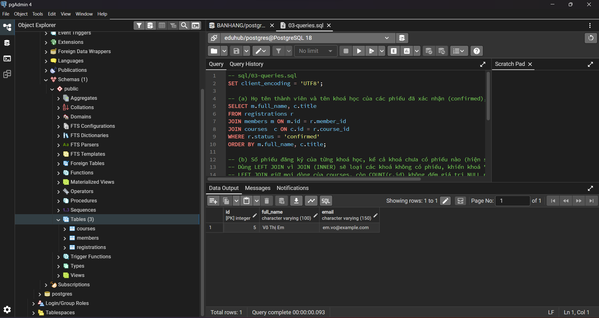
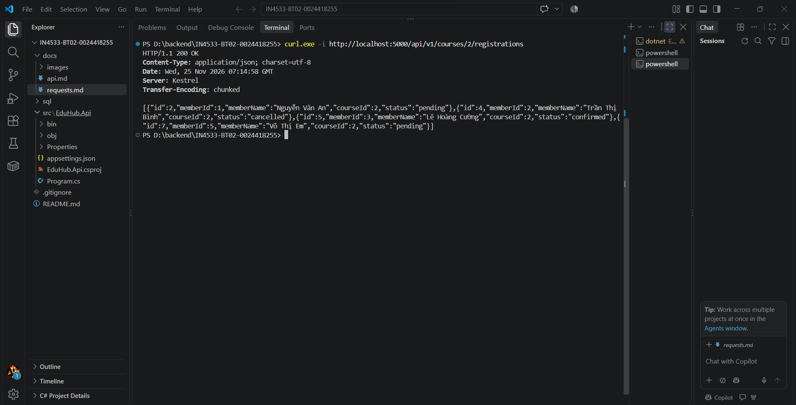

# IN4533-BT02-0024418255 – EduHub mini (PostgreSQL + REST API)

- Họ tên: Trần Minh Trung Kiên
- MSSV: 0024418255
- Học phần: Lập trình Back End (IN4533) – Bài tập 02

## 1. Cách cài PostgreSQL

<!-- SỬA lại cho đúng cách em đã cài (cài trực tiếp / Docker / dịch vụ trực tuyến). -->
Cài trực tiếp PostgreSQL trên Windows bằng bộ cài chính thức (kèm pgAdmin 4), cổng mặc định 5432, user `postgres`. Kết nối thành công bằng pgAdmin 4:



## 2. Cách chạy cơ sở dữ liệu

```bash
psql -U postgres -c "CREATE DATABASE eduhub;"
psql -U postgres -d eduhub -f sql/01-schema.sql
psql -U postgres -d eduhub -f sql/02-seed.sql
psql -U postgres -d eduhub -f sql/03-queries.sql
```

(Hoặc mở từng tệp trong Query Tool của pgAdmin và chạy theo thứ tự 01 → 02 → 03.)

## 3. Cách chạy API (Minimal API, mục 3.2)

Yêu cầu: .NET SDK (dự án đặt `net10.0` trong `EduHub.Api.csproj`; nếu dùng bản khác, sửa `TargetFramework`).

```bash
cd src/EduHub.Api
dotnet add package Npgsql
# Đặt chuỗi kết nối thật bằng user-secrets (không commit mật khẩu):
dotnet user-secrets init
dotnet user-secrets set "ConnectionStrings:EduHub" "Host=localhost;Port=5432;Database=eduhub;Username=postgres;Password=<mat-khau-cua-ban>"
dotnet run
```

API lắng nghe tại `http://localhost:5000`. Các lệnh thử nằm trong [docs/requests.md](docs/requests.md); thiết kế API trong [docs/api.md](docs/api.md).

Đã cài đặt: `GET /api/v1/courses/{courseId}/registrations` và `POST /api/v1/courses/{courseId}/registrations`.



> Không có mật khẩu hay thông tin kết nối thật trong kho này (`appsettings.json` chỉ chứa giá trị giữ chỗ).
